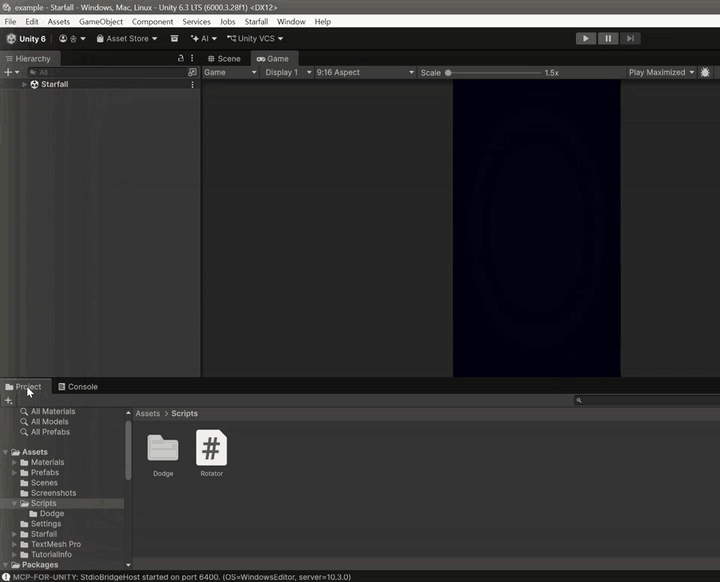

# unity-dev-skills

[](https://github.com/HaminSong/unity-dev-skills/actions/workflows/scaffold.yml)
[](LICENSE)
[](https://github.com/HaminSong/unity-dev-skills/releases)
[](https://unity.com)
[](https://docs.claude.com/en/docs/claude-code/plugins)

[English](README.md) | **한국어**

AI 코딩 에이전트와 함께 Unity 게임을 만들기 위한 에이전트 스킬 모음입니다. Claude Code에서 만들고 검증했으며, 스킬 형식과 생성되는 파일은 Claude 전용이 아닙니다.

이 문서는 한국어 요약입니다. 자세한 내용은 [영어 README](README.md)에 있습니다.

## unity-project-setup

**Unity 프로젝트를 AI 에이전트에게 맡기기 위한 밑작업과 규약.**

에이전트는 저장소에 다음이 적혀 있을 때 일을 잘합니다.

- 코드를 어디에 둘지
- 무엇을 건드리면 안 되는지
- 자기 작업을 어떻게 확인할지
- 다음 세션에 어떻게 넘길지

이 답이 사람 머릿속에만 있으면 에이전트는 추측합니다. 이 스킬은 첫날부터 그 답을 실제 파일로 프로젝트에 깝니다.

- 컴파일러가 강제하는 폴더와 어셈블리
- Editor API로 적용하는 프로젝트 설정
- 에이전트가 가장 먼저 읽고 계속 최신으로 유지하는 `docs/` 문서

규칙은 미리 설계한 것이 아닙니다. 한 명의 개발자가 여러 AI 에이전트와 같은 저장소, 같은 Unity 에디터를 나눠 쓰며 개발 중인 모바일 게임에서 실제로 문제를 겪을 때마다 하나씩 생겼습니다. 예를 들면 이런 일들입니다.

- 리팩터링 때 366줄(목표 220줄)이던 파일이 상한 규칙이 없어 한 달여 뒤 1,528줄이 됐습니다.
- 규칙을 순수 C#으로 옮기자 테스트가 95개에서 286개로 늘었습니다.
- 상점에 표시된 값과 실제 적용되는 값이 달랐습니다.

규칙마다 어떤 일이 있었는지는 [`why-these-rules.md`](plugins/unity-project-setup/skills/unity-project-setup/references/why-these-rules.md)에 정리되어 있습니다(영어).



*실행 중인 Unity 6.3 에디터에서 기존 프로젝트에 적용하며 녹화했습니다. 레이어 폴더가 생기고 Apply Defaults가 실행된 뒤, Gameplay를 참조한 UI 스크립트를 컴파일러가 막습니다.*

### 이렇게 요청하면 됩니다

- *"이 Unity 프로젝트 세팅해 줘 — 폴더, 어셈블리, 코딩 규칙까지."*
- *"방금 `D:\Dev\Orbit`에 빈 Unity 프로젝트를 만들었어. 접두어 `Orbit`, 가로 화면으로 세팅해 줘."*
- *"AI 에이전트 여럿이 나눠서 작업할 수 있게 준비해 줘."*

에이전트가 접두어, 이름, 화면 방향, 뺄 레이어를 한 번에 묻고, 무엇이 생길지 미리 보여 준 뒤 아래를 만듭니다.

```
Assets/
  Art/ Audio/ Data/ Materials/ Prefabs/ Scenes/ Settings/ Shaders/ ThirdParty/
  Scripts/
    Core/            Game.Core        순수 C# (noEngineReferences): 규칙, 계약, 이벤트
      Tests/EditMode Game.Core.Tests  EventBus 테스트 13개
    Data/            Game.Data        ScriptableObject 수치와 콘텐츠
    Gameplay/        Game.Gameplay    물리, 입력, 월드, 카메라, 오디오
    UI/              Game.UI          HUD와 화면 — Gameplay를 참조하지 않음
    Persistence/     Game.Persistence 저장
    Bootstrap/       Game.Bootstrap   합성 루트 (싱글톤 없음)
    Editor/          Game.Editor      Tools > Project Setup > Apply Defaults
docs/                목차, 구조 지도, 설계·SOLID, 코딩 규칙, 협업, 작업 흐름, 지시서 틀
.claude/skills/ship-to-develop/       커밋 → develop 병합 → push는 따로 승인받은 뒤에만
AGENTS.md  CLAUDE.md  .editorconfig  .gitattributes  .gitignore
```

Unity 공식 [`unity:new-unity-project`](https://github.com/Unity-Technologies/unity-agent-plugin) 스킬과 함께 쓰도록 만들었습니다. 공식 스킬이 프로젝트를 만들고 패키지를 설치하면, 이 스킬이 그 위에 구조와 규칙을 얹습니다.

## 설치

### Claude Code (플러그인, 추천)

```
/plugin marketplace add HaminSong/unity-dev-skills
/plugin install unity-project-setup@unity-dev-skills
```

### 다른 에이전트 (Codex 등 `SKILL.md`를 읽는 도구)

`plugins/unity-project-setup/skills/unity-project-setup/` 폴더를 그 에이전트의 스킬 폴더(예: `~/.codex/skills/`, `~/.agents/skills/`)에 복사합니다. Codex용 플러그인 파일(`.agents/plugins/marketplace.json`, `.codex-plugin/plugin.json`)도 들어 있습니다. 다만 이 경로들은 **Claude Code에서만 실제로 테스트했습니다**.

### 필요한 것

- Input System과 Test Framework 패키지가 있는 Unity 6 프로젝트(없으면 스크립트가 경고합니다)
- PowerShell: Windows PowerShell 5.1(기본 내장) 또는 PowerShell 7(`pwsh`). Windows, macOS, Linux 모두 CI로 확인합니다.
- 선택: Git, Git LFS, [`unity-cli`](https://github.com/Unity-Technologies/unity-agent-plugin)(에이전트가 에디터 새로고침·메뉴 실행·테스트를 직접 하려면)

## 사용 전에 알아 둘 것

**새 프로젝트나 거의 빈 프로젝트**를 위한 스킬입니다. 코드가 컴파일되는 방식과 에디터 동작을 바꿉니다.

- **폴더 9개와 레이어별 어셈블리를 항상 만듭니다.** 비어 있어도 만들며, `Data`, `UI`, `Persistence`만 `-Skip`으로 뺄 수 있습니다.
- **어셈블리가 참조 범위를 바꿉니다.**
  - 레이어 어셈블리는 `Assembly-CSharp`를 참조할 수 없습니다. 따라서 asmdef가 없는 에셋스토어 에셋은 레이어 코드에서 쓸 수 없습니다.
  - 레이어 폴더(예: `Assets/Scripts/UI`)에 이미 코드가 있으면 스캐폴드가 아무것도 쓰지 않고 멈춥니다. 이미 스크립트가 있는 기존 프로젝트는 스크립트를 무작정 돌리지 말고 [`setup-decisions.md`](plugins/unity-project-setup/skills/unity-project-setup/references/setup-decisions.md)의 도입 절차를 따르세요.
- **Apply Defaults가 바꾸는 설정:**
  - **Input System 전용:** 옛 `UnityEngine.Input`을 쓰는 코드는 실행 중 에러가 납니다. 패키지가 없으면 바꾸지 않고 경고만 합니다.
  - **Linear 색 공간:** 기존 아트의 색감이 달라집니다.
  - **빠른 Play 모드(Domain Reload 끔)는 선택 사항**이며, 기본값은 Unity 기본(켜짐)입니다.
- **git 규칙은 정해진 방식이 있습니다.**
  - 협업자 모두 Git LFS가 필요합니다. `git lfs install --local`이라 이 저장소에만 적용됩니다.
  - 씬과 프리팹은 Unity 스마트 병합(UnityYAMLMerge) 대상입니다. 이 병합 도구는 PC마다 한 번씩 연결해 줘야 합니다(생성되는 `docs/collaboration.md` 2a절).
  - `main` + `develop` 흐름을 쓰며, `ship-to-develop`은 **push 전에 따로 승인을 받습니다**.
- **덮어쓰거나 지우지 않습니다.** 이미 있는 파일은 건너뛰고, 실행 전에 무엇이 생길지 먼저 보여 줍니다.

## 에이전트가 스스로 일할 수 있게 하는 장치

| 에이전트에게 필요한 것 | 해결하는 장치 |
|---|---|
| 아이디어를 변경으로 옮기는 흐름 | `docs/workflow.md`: 제안 먼저, 결정은 사용자, 그다음 계획 → 구현 → 확인 → 문서 갱신. **사용자가 정하기 전에는 게임을 바꾸지 않습니다** |
| 어디서 시작할지 | `AGENTS.md`(`CLAUDE.md`가 불러옴)가 `docs/` 목차로 안내 |
| 코드를 어디에 둘지 | 폴더 = 레이어 어셈블리. 잘못된 방향의 참조는 리뷰가 아니라 **컴파일 오류**로 드러남 |
| 스스로 확인하기 | Core는 순수 C#이라 EditMode 테스트가 에디터 창 없이 돌아감. 확인하지 못한 것은 확인하지 못했다고 말하는 규칙 |
| 세션 간 인수인계 | 문서가 곧 인수인계. 끝내기 전에 관련 문서를 지금 상태로 고침 |
| 병렬 작업 | 지시서 틀, 서브 작업마다 별도 작업 폴더(worktree), 메인만 고치는 파일(씬, 합성 루트), 시작 전 파일 겹침 확인 |
| Unity 에디터 함께 쓰기 | Play 상태 먼저 확인, 내가 켠 Play는 내가 끄기, 테스트 전 프리팹 편집 화면 닫기 |
| 안전한 커밋 | 내 파일만 담기, 테스트 후 커밋, 커밋 뒤 작업 트리를 건드리지 않고 develop 받기, push는 명시적 승인, 강제 금지 |
| 구조를 키울 때 | 파일 줄 수 제한과 미리 적어 둔 확장 조건 |

**이 스킬이 하지 않는 것:** 이 스킬만으로 에이전트가 알아서 다 하게 되지는 않습니다. 무엇을 만들지 정하고, 검토하고, `main`에 반영하는 것은 사람이 합니다.

## 검증 상태 (0.2.2)

- **자동(CI, `main` push와 PR마다):** 두 스크립트를 PowerShell 7(Ubuntu, macOS, Windows)과 Windows PowerShell 5.1에서 실행합니다.
  - [`tests/scaffold.Tests.ps1`](tests/scaffold.Tests.ps1) 검사 53개: 실행 · 다시 실행 · 레이어 빼기 · 옵션, 경로 끝 구분자, 코드가 이미 있는 레이어 폴더에서 아무것도 쓰지 않고 멈추기 등
  - [`tests/ship-sync.Tests.ps1`](tests/ship-sync.Tests.ps1) 검사 15개: 남의 커밋 안 된 작업이 있는 임시 저장소에서 `ship-to-develop` git 단계 — 로컬 `develop`이 없는 새 클론, 뒤처지기만 한 `develop` 앞으로 감기(작업 트리 그대로), 양쪽에 커밋이 있을 때 멈춤과 승인 뒤 병합. 0.2.1의 "커밋 전 `git pull --rebase`"가 같은 상황에서 거부되는 것도 확인합니다.
- **작성자가 직접 실행(Unity 6000.3.28f1, 배치 모드):**
  - 생성된 코드가 컴파일되고, 스크립트가 폴더에 맞는 어셈블리로 들어갑니다.
  - Apply Defaults가 설정을 적용하고 저장합니다. Input System 패키지가 없으면 입력 설정을 건드리지 않습니다.
  - EditMode 테스트 13/13 통과. 이 중 Publish 메모리 할당 검사는 실제로 할당이 생기면 실패하는 것까지 확인했습니다.
  - 금지된 참조는 컴파일 오류가 납니다: Core → UnityEngine(`CS0246`), UI → Gameplay(`CS0234`).
  - 0.2.2 재실행(URP 17.3.0까지 넣은 새 프로젝트): 레이어마다 스크립트를 넣으면 어셈블리 8개가 모두 빌드되고 패키지 참조(TextMeshPro, uGUI, Input System, URP)가 풀립니다. Apply Defaults 설정 6가지 저장, 테스트 13/13 통과. `<접두어>.Editor` 네임스페이스 안의 `: Editor`는 `CS0118`, `: UnityEditor.Editor`는 컴파일됩니다.
  - git 단계: `main` 먼저 커밋 후 `develop`, 전역 설정을 바꾸지 않는 LFS, UnityYAMLMerge 병합, 원격 없는 `ship-to-develop` 순서
- **실행 중인 에디터, 기존 프로젝트(작성자가 직접 실행):** 설치한 플러그인을 에이전트가 스크립트 23개와 커밋 안 된 작업이 있는 Unity 6.3 프로젝트에 적용했습니다.
  - 레이어 어셈블리는 기존 코드 옆에 추가됐고, 기존 코드는 `Assembly-CSharp`에 그대로 남아 컴파일됐습니다.
  - Tools 메뉴에서 Apply Defaults가 실행됐습니다.
  - Test Runner에서 13/13 통과했습니다.
  - `CS0234` 위반이 Console에 떴습니다(위 GIF).
  - `ship-to-develop`을 따라 커밋했습니다. 작업 중이던 파일은 담지 않고, `feat/` 브랜치에서 커밋해 `develop`에 병합한 뒤, **push 전에 멈추고 승인을 요청**했습니다.
- **아직 확인하지 않은 것:**
  - CI에서 Unity 컴파일과 테스트
  - Claude Code 외 에이전트에 설치
  - 기존 프로젝트의 스크립트를 레이어로 옮기기(`setup-decisions.md`의 도입 절차)

## 라이선스

[MIT](LICENSE). 포함된 `.gitignore` 템플릿은 [github/gitignore](https://github.com/github/gitignore)(CC0-1.0), `.gitattributes` 템플릿은 [gitattributes/gitattributes](https://github.com/gitattributes/gitattributes)(MIT)에서 가져왔으며, 각 파일에 출처 표기가 남아 있습니다.
