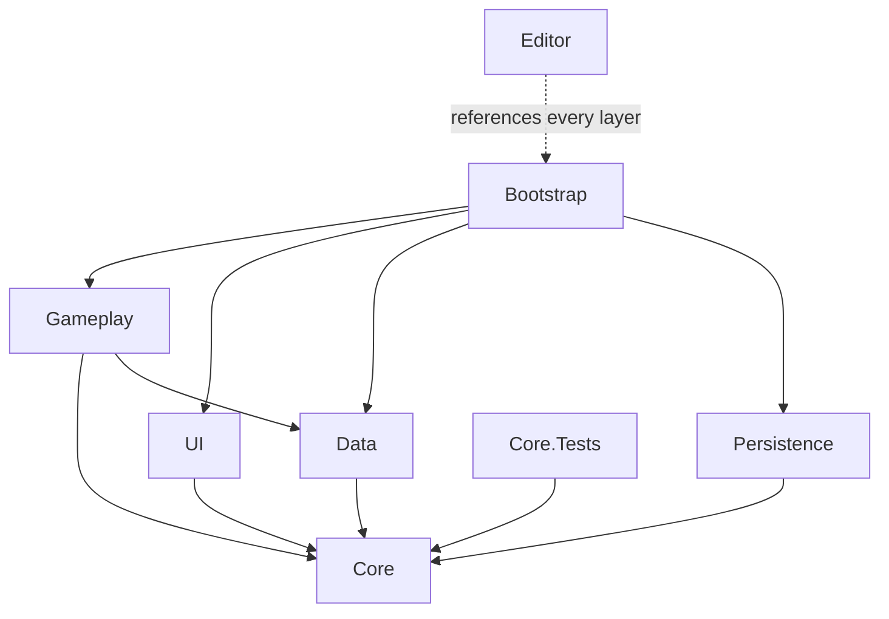

# Architecture design

- **Created** {{DATE}}
- **Purpose** How the code is split into layers, why, and when the structure should grow. What the code actually looks like today (class lists, flows) lives in [ARCHITECTURE_MAP.md](ARCHITECTURE_MAP.md).

## 1. Principles

1. `{{PREFIX}}.Core` is pure C# and never references UnityEngine (`noEngineReferences`). Rules, calculations and decisions live here and are pinned down by EditMode tests.
2. No global singletons. The composition root (`GameBootstrapper`) creates each service once and injects it where needed.
3. Visuals, audio and camera effects subscribe to events. Game rules never know about UI or presentation code.
4. Tunable numbers and content live in ScriptableObject data. Values serialized in scenes override code defaults — check both when changing one.

## 2. Layers and assemblies

| Assembly | Folder | Responsibility | References |
|---|---|---|---|
| `{{PREFIX}}.Core` | `Scripts/Core` | Pure rules, calculations, contracts (interfaces), events, save DTOs | None (`noEngineReferences`) |
| `{{PREFIX}}.Data` | `Scripts/Data` | Tuning values and content definitions (ScriptableObjects) | Core |
| `{{PREFIX}}.Gameplay` | `Scripts/Gameplay` | Physics, input, world objects, camera, audio playback | Core, Data, Input System (, URP) |
| `{{PREFIX}}.UI` | `Scripts/UI` | HUD, screens, popups | Core, uGUI, TextMeshPro, Input System (, URP) |
| `{{PREFIX}}.Persistence` | `Scripts/Persistence` | Save file I/O (implements `ISaveService`) | Core |
| `{{PREFIX}}.Bootstrap` | `Scripts/Bootstrap` | Composition root, scene transitions. The only layer that knows every other | Core, Data, Gameplay, UI, Persistence |
| `{{PREFIX}}.Editor` | `Scripts/Editor` | Editor menus, asset generation, inspector tools (Editor only) | All |
| `{{PREFIX}}.Core.Tests` | `Scripts/Core/Tests/EditMode` | Core EditMode tests (Editor only) | Core, TestRunner, nunit |

asmdef references are not transitive: an arrow means a direct reference in that asmdef. For readability, the diagram draws Editor's references as one dotted arrow; the `Editor` asmdef lists every layer directly, as the table says.

Rules:
- **Core references nothing.** Not even `Vector3` — define a small value type in Core if needed.
- **UI and Gameplay never reference each other.** UI sees only Core's `I*View` (read) and `I*Control` (request) interfaces. Gameplay classes implement them; Bootstrap connects the two.
- **Before adding an asmdef reference**, check it follows the arrows above. If you need one against the arrows, lift an interface into Core instead.
- Before creating a new layer, check whether a folder inside an existing layer is enough.

## 3. SOLID — where this structure enforces it

| Principle | Here | Warning signs |
|---|---|---|
| S — Single responsibility | Decisions in Core, flow in small plain C# `*Director` classes in Gameplay, screens in UI. File size limits (coding-guidelines §4) | One class handles input, flow, decisions and rewards; a file passes 400 lines |
| O — Open/closed | New content = ScriptableObject data + one behaviour class per kind. New signal = new event | Every new enemy or item edits one central `switch`; fields are squeezed into an existing event |
| L — Liskov substitution | Implementations of an interface keep the same promises (e.g. the `IDisposable` from `Subscribe` is safe to dispose twice) | "Except in this case" branches per implementation |
| I — Interface segregation | Split read `I*View` / `I*Reader` from write `I*Control` / `I*Writer` | UI receives a large interface that exposes write methods |
| D — Dependency inversion | Contracts in Core, implementations in outer layers, wiring in Bootstrap | `FindObjectOfType` or a singleton `Instance` used to reach other objects |

## 4. Growth triggers

Grow the structure when it is needed, not before. Write the triggers down in advance so you neither over-build early nor hesitate when the time comes.

- When the composition root grows with service, world and UI wiring (around 500 lines), split it into installers.
- When progress flags start conflicting with each other, introduce an explicit state object inside that Director.
- When effect ordering gets complex (buffs, upgrades and equipment stacking), introduce a modifier stack.
- (Add the triggers this game is likely to hit)

## 5. Technical debt

(Record what was knowingly left as is, why, and the condition for cleaning it up)
